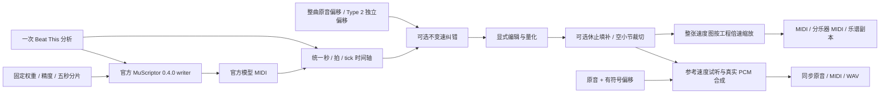

# MIDI 时间轴与导出 / MIDI timing and export

## 中文

MuScriptor 推理包现已固定到未修改的官方 0.4.0（`8a1ef88672cc23c26619adaff37ec48d82c0b906`），仍使用原有三档权重、精度和五秒分片。官方 writer 接收项目唯一一次 Beat This 分析；速度图、编辑、量化和导出通过共享层贯通所有后端，不新增转换路线。桌面和 Docker 保持 Torch 2.7 / NumPy 1.26，Space/Colab 使用各自既有运行时；上游 NumPy 2 元数据下限源于 uv 的平台分支解析，实际兼容性由固定源码、真实推理和跨平台测试核验。

秒、四分音符拍与 MIDI tick 使用同一张可逆 tempo map，贯通结果试听、钢琴卷帘、编辑、量化、MIDI/WAV、逐乐器导出与乐谱副本。自适应速度图不再在结果页压平成单一 BPM。工程 BPM/工程倍速按比例缩放整张图，并同步改变原音和 MIDI 的真实播放速度。

“节拍纠错与导出整理”是独立的显式操作。BPM、拍号、首拍和倍频纠错只重新解释节拍网格，不改变原音演奏速度，不重新识别。BPM 留空保留原图；填写 BPM 表示纠正后的恒速网格。首拍按原音秒数填写，必要的小节前置留白通过同一偏移标记同步到原音。倍频 ×2 同时把 4/4 解释为 8/4，显式填写的拍号优先。

Type 0/1 MIDI 的原音偏移属于整首曲目，即使 `muscriptor:bar_offset=` 只在 conductor 轨中出现，所有轨道也须共用。纠错前解析一次；首拍纠错、BPM／倍频组合及后续裁切沿用该起点。Type 2 的独立序列分别保留自己的起点。不能逐轨把缺少标记解释成零，否则重复纠错会错移乐器轨。

量化保留 `1/4`、`1/8`、`1/16`、`1/32`、`1/64` 五档及默认 `1/32`。三连音为所选步长的 2/3；强度为 0–100%，默认 100%；自动网格按音符起点和时值从五档中选择。切换设置不改音符，只有点击量化或 `quantize_notes=true` 才执行。结果编辑器默认全部轨道，也可选择所选音符；Web/API、CLI、Docker 与便携 Web 处理全部轨道。变速处先映射到音乐拍，再量化并映回秒；普通量化保留所有非音符事件的绝对 tick。

以下选项默认关闭，仅在用户明确应用时执行，源 MIDI 和源音频均保留：

- 短休止填补：按乐器延长到下一个起音，只处理不超过指定四分音符拍数的间隙，鼓不延长。
- 裁掉开头空小节：整体移动事件及速度图，并同步裁切原音；负偏移表示原音头部被裁掉。
- 速度图平滑与简化：局部二次拟合，优先保留小节边界，同时验证相对原图的误差不超过 25 ms 和 1/16 拍；无法满足时明确报错。

桌面、Space、Colab 结果页提供相同选项；独立 Web 在转换设置中提供。Docker、便携 Web、可执行桌面分别复用对应入口。既有 PDF、MusicXML、总谱、分谱与适用的 Tab 导出继续使用量化副本，并保留三连音、强度和自动网格设置。

### API 与 CLI

`InferenceOptions`、`ManualMidiOptions` 增加 `quantize_strength`（0–1）、`quantize_triplet`、`quantize_auto`。可选 `midi_export` 对象支持 `bpm`、`beats_per_bar`、`beat_unit`、`first_downbeat`、`beat_scale`、`fill_gaps`、`trim_leading_bars`、`smooth_tempo`。默认保留原有输出行为；`custom_bpm` 继续表示真实工程变速。

```json
{
  "quantize_notes": true,
  "quantize_grid": "1/16",
  "quantize_strength": 0.5,
  "quantize_triplet": true,
  "midi_export": {
    "bpm": 90,
    "beats_per_bar": 3,
    "beat_unit": 4,
    "first_downbeat": 1.2,
    "fill_gaps": 0.125,
    "trim_leading_bars": true
  }
}
```

CLI 参数为 `--grid-bpm`、`--beats-per-bar`、`--beat-unit`、`--first-downbeat`、`--beat-scale`、`--quantize-strength`、`--quantize-triplet`、`--quantize-auto`、`--fill-gaps`、`--trim-leading-bars`、`--smooth-tempo`；量化仍须显式提供 `--quantize`。

工程与参考 BPM 沿用现有 4–400 范围；倍频结果或叠加后的工程速度超出范围时明确报错，不截断数值。内部 `music-to-midi:playback_rate=` 元数据记录真实工程倍率，解决裁切后变速图只剩一个速度段时无法区分“固定网格”和“已真实变速”的问题；重新打开、试听和再次下载均按该信息恢复参考时间轴。

独立 HTTP 乐谱入口 `/api/v1/jobs/{id}/sheet-music` 与 `/api/v1/project-results/{id}/sheet-music` 同时接受 `quantize_grid`、`quantize_strength`、`quantize_triplet`、`quantize_auto` 查询参数；每组设置独立缓存。桌面与共用 Web 编辑器沿用相同设置生成排版副本，原始及当前编辑 MIDI 不被乐谱排版覆盖。



`tests/test_midi_timing_workflow.py` 使用真实 SMF、控制器、SysEx 和 PCM 验证。运行 `venv/Scripts/python scripts/verify_midi_timing_ui.py` 后，可在 `/timing/zh_CN`、`/timing/en_US` 操作生产共用浏览器结果组件；根路径是独立 Web。测试资源由真实 FluidSynth 合成，不加载转写模型、不使用用户音频或生产数据。

## 验收记录（2026-10-21）

后续整曲、Windows／Linux、真实设备、浏览器下载及候选包验证见 [2026-10-24 发版复核](releases/v1.10.0.md#2026-10-24-验收结果)；以下保留上一阶段的原始记录。

全工作区测试为 1,851 项通过、5 项设备验收跳过；最后一次浏览器 BPM 输入提交修正后，受影响路径的 126 项再次通过，其中包含一项新增回归。没有将两个测试批次的重叠用例相加。中英文分别验证 660 个桌面／共享键和 283 个独立 Web 键的解析、完整性、占位符及新增文案无回退。

| 交付面 | 对应证据与边界 |
| --- | --- |
| 桌面、便携 App、可执行 App | `test_result_editor_actions.py`、`test_muscriptor_integration.py`、`test_midi_timing_controls.py`；`test_midi_timing_workflow.py` 以真实 FluidSynth / SoundFont 验证手动变速后的纠错与原音对齐。便携与可执行入口通过原有构建契约检查，未重打包。 |
| Space、Colab | `test_platform_ui_parity.py`、`test_project_gradio_paths.py`；在真实 Chrome 操作生产共用结果组件，验证三连音、强度、自动网格、纠错、播放和下载。未声明云端部署已更新。 |
| 独立 Web/API、便携 Web | `test_web_api.py`、`test_project_frontends.py`、`test_edited_midi_preview.py` 及主／逐轨引擎真实 SMF 后处理回归；真实 Chrome 验证中英文设置及 320px 无横向溢出。 |
| CLI | `test_native_cli.py` 对主任务、逐轨任务验证全部新参数送达引擎；既有节拍来源、分发和启动契约随全量回归通过。 |
| Docker | `test_deployment_runtime_contract.py`、`test_docker_cli_working_directory.py` 及独立 API/CLI 契约；复用共享模块，不修改镜像依赖，本轮未重建或发布镜像。 |
| 乐谱与音频文件 | 真实 MuseScore 4.7.4 生成 `score.mid`、`score.musicxml`、总谱 PDF、钢琴分谱 PDF 和 manifest；manifest 核对自动网格 1/64、75% 强度与三连音。使用真实 PCM 验证负偏移裁切，使用生产浏览器 MIDI 序列化器核对速度图、事件与释放力度。 |

五项跳过分别是两项 ChordMini / 音频设备集成、两项和弦设备播放及一项显式 Windows 音频设备验收。本轮未重新执行七模式模型推理全验收、云端部署、Linux GPU 容器或重建后的发布包验收。浏览器确认 MIDI 下载完成事件；下载管理器受浏览器工具策略限制，未读取其中的落盘路径，文件字节正确性由生产序列化器的真实 SMF 回读独立验证。

提交前的一次额外全量检查，在项目创建／运行／重开测试中出现一次 Windows `PermissionError [WinError 5]`，指向项目 JSON 清单。该测试单独复核及连续 10 次独立复测均通过；项目状态文件的读写锁实现本轮未修改，具体原因尚未确认。没有通过修改测试、吞掉错误或加入假成功回退来消除该记录，也不声称已根治所有 Windows 文件访问冲突。随后单独执行的最终全量回归为 1,851 项通过、5 项设备验收跳过，未再次出现该错误。

## English

The [2026-10-24 candidate audit](releases/v1.10.0.md) adds whole-song, physical-device, Windows/Linux, browser-download and packaged-runtime evidence. The earlier validation record below is retained as originally observed.

The inference package now pins unmodified official MuScriptor 0.4.0 (`8a1ef88672cc23c26619adaff37ec48d82c0b906`), with the same three checkpoints, precision and five-second windows. Its writer receives the single project Beat This analysis. Shared timing, editing, quantization and export integrate these capabilities across all backends without adding a conversion route. Desktop and Docker keep Torch 2.7 / NumPy 1.26; Space/Colab keep their platform runtimes. Upstream's NumPy 2 metadata floor separates uv platform resolution branches; fixed-source checks, real inference and cross-platform tests verify actual compatibility.

One reversible tempo map connects seconds, quarter-note beats and MIDI ticks throughout playback, piano-roll editing, quantization and MIDI/WAV/stem/sheet exports. Adaptive maps survive the workbench. Project BPM/speed scales the whole map and changes linked original/MIDI playback speed together.

Grid correction is separate and explicit: BPM, meter, first downbeat and beat scale reinterpret the grid without changing source-relative performance timing or transcribing again. Leave BPM blank to retain the map. A supplied BPM requests a corrected fixed grid. Downbeats are measured in original-audio seconds; bar padding is shared with the source. A ×2 beat scale changes 4/4 to 8/4 unless a meter is explicitly supplied.

Type 0/1 MIDI tracks share one source-audio offset even when `muscriptor:bar_offset=` appears only in the conductor track. It is resolved once before correction and retained through downbeat/BPM/beat-scale combinations and trimming. Type 2 sequences retain independent origins. Treating an unmarked instrument track as zero would misalign repeated corrections.

The five grids and default 1/32 are retained. Triplets multiply the step by 2/3; strength is 0–100%, default 100%. Automatic selection evaluates note starts and durations. Settings alone never edit notes. Editors default to all tracks and also support selected notes; API/CLI/Docker/portable Web process all tracks. Quantization follows musical beats across tempo changes and preserves non-note event ticks.

Gap filling, trimming and smoothing are off by default. Gap filling extends melodic notes across explicitly bounded rests. Trimming moves all events and the map together and crops the original audio through a signed offset. Smoothing uses a local quadratic fit and prefers bar anchors, enforcing both 25 ms and 1/16-beat limits; it reports failure when those bounds cannot be met. Original MIDI/audio files remain intact.

Desktop, Space, Colab and standalone Web expose the options; Docker and portable/executable entries reuse their implementations. Existing PDF, MusicXML, score, part and applicable Tab exports retain triplet/strength/automatic-grid settings on a private copy. The API example and CLI flags above apply to both languages; `custom_bpm` remains true project speed. The regression tests use real SMF/PCM, and the local UI script serves the production shared component in both supported languages using real FluidSynth assets.

Project/reference BPM retains the existing 4–400 range. A beat-scale result or combined project speed outside it fails explicitly instead of clipping. The internal `music-to-midi:playback_rate=` marker restores the reference timeline even when trimming leaves a single tempo segment. Both standalone job and saved-project sheet endpoints accept the four quantization query parameters listed above and cache each settings combination separately.

Validation passed 1,851 complete-workspace tests with five explicit device-acceptance skips. After the last browser BPM input fix, 126 affected-path tests passed again, including one new case; overlapping batches are not added together. Both locales passed full-catalog checks across 660 shared/desktop and 283 standalone-Web keys each. Real Chrome exercised both languages, 320px layouts, playback, corrections, quantization and completed MIDI download events. Production serialization was independently round-tripped as real SMF; browser policy prevented reading download-manager paths. Real FluidSynth and MuseScore generated audio and a five-file score package whose manifest retained 75% strength, triplets and automatic 1/64 selection. The table above names separate delivery contracts; no cloud/image deployment, portable rebuild, seven-model inference sweep or physical-device acceptance is claimed.

One additional pre-push full-suite run encountered a Windows `PermissionError [WinError 5]` on a project JSON manifest during the create/run/reopen scenario. The individual check and ten independent repeats all passed. The project state-lock implementation is unchanged, and the exact cause remains unconfirmed. Tests and error handling were not relaxed, and this does not claim to eliminate every Windows file-access conflict. A subsequent standalone full-suite run passed 1,851 tests with five device-acceptance skips, without reproducing the error.
