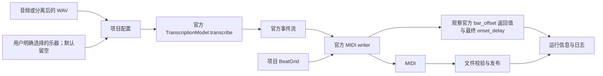

# MuScriptor 模型研究、分数与项目定位

> 核验日期：2026-08-08。本文只记录可追溯到官方模型卡、论文、代码仓库、Mirelo 官方文章或公开挑战论文的结论。不同数据集和评测协议的分数不混排。

## 1. 结论

MuScriptor Large / Medium / Small 是开放权重的完整混音多乐器 AMT 模型。本项目在 `SMART` 和分离后逐 WAV 转 MIDI 中分别提供三档选择，Large 作为质量优先档。

作者的 372 首多乐器 `D_Test` 报告显示，Large 的 Multi F1 为 47.8，同表 YourMT3+ 基线为 21.9。论文列出的 8 个公开跨域数据集中，Large 有 6 个 Multi F1 更高，在 RWC-C 和 RWC-R 上较低；Onset 与 Offset 指标也有输有赢。公开实现还存在这些边界：不输出 velocity、使用 36 组乐器分类、稀有乐器数据较少、显存与算力需求较高，权重采用 CC BY-NC 4.0 非商用许可。

现有证据支持把 MuScriptor Large 列为公开完整混音 AMT 的优先候选，也能证明它在作者数据上高于论文采用的 YourMT3+ 基线。这些数据不能证明它是跨所有 benchmark 的无条件 SOTA；独立、同协议复测仍是形成跨模型结论所缺少的证据。

## 2. 模型身份与发布时间

| 项目 | 已核实信息 |
|---|---|
| 开发者 | Kyutai、Mirelo AI、IRCAM 研究人员 |
| 论文 | [MuScriptor: An Open Model for Multi-Instrument Music Transcription](https://arxiv.org/abs/2607.08168)，arXiv v1：2026-07-09 |
| 官方代码 | [muscriptor/muscriptor](https://github.com/muscriptor/muscriptor)，MIT；最新公开 release `v0.3.0`：2026-08-05 |
| 官方权重 | [MuScriptor/muscriptor-large](https://huggingface.co/MuScriptor/muscriptor-large)，gated、CC BY-NC 4.0，并附额外合法使用条件 |
| Hub 时间 | [Hugging Face API](https://huggingface.co/api/models/MuScriptor/muscriptor-large) 记录仓库创建于 2026-06-30、最后更新于 2026-07-10 |
| 本项目固定代码 | 未修改的官方 `v0.3.0` commit `d73147e75e5b9b0c0a79ebe154587db4fd603e0c`，七个运行时源码文件均经 SHA-256 身份校验。产品默认使用官方 `TranscriptionModel`，另有显式可选的下游 TelkNet Issue #74 子类；项目向官方 writer 提供项目 BeatGrid。writer 可执行 onset 校正和小节对齐，不能据此声称最终 MIDI 保持模型原生秒数；见下方 2026-10-12 复核 |
| 本项目固定权重 | revision `8809fdfbed2affa7ade94a7059e746e3880720e7`，`model.safetensors` 5,465,642,136 bytes |
| Intel XPU 加载 | `safetensors==0.8.0` 官方 `pread`；先打开惰性文件句柄，再建立约 5.50 GiB 统一内存模型，随后按偏移逐张量复制；读取失败时停止加载 |

发布时间线：Hub 仓库在正式发布前已于 6 月 30 日建立；论文和 Mirelo 文章在 7 月 9 日发布；当前权重 revision 在 7 月 10 日更新；官方源码 `v0.3.0` 在 8 月 5 日发布。Hub 的 `createdAt` / `lastModified` 是仓库元数据时间，不是训练完成时间，也不表示更早已有同一套公开代码、文档和最终 revision。

### 分段衔接

- `标准（默认）`：直接实例化固定上游的 `TranscriptionModel`，不运行下述状态恢复或边界音符合并，严格保留官方分段输出。
- `跨段延音衔接`：显式可选项。在保持官方权重、tokenizer、5 秒窗口和 MIDI writer 的前提下，打破混合编制反复继承单一 program 后形成的分段自强化状态，同时保留真实 tie；另只合并严格命中 5 秒边界、并在后三个 10 ms 帧内重启的同乐器同音高连续音符，用于同输入 A/B。

分段衔接只控制 MuScriptor 的分段状态，与模型大小、乐器选择和速度方案分别设置。

## 3. 架构、训练数据与输出能力

- decoder-only Transformer；模型卡把 Large 写作约 1.3B 参数，当前代码 README 四舍五入写作 1.4B，结构为 48 层、隐藏维度 1536、24 个注意力头。
- 输入为 16 kHz 单声道音频的 5 秒分片，使用 512-bin mel-spectrogram，100 Hz 帧率。
- 输出为 MT3 风格事件序列，包含 onset、offset、pitch 和 instrument；128 个 MIDI program 映射到 `MT3_FULL_PLUS` 的 36 个乐器组。
- 训练链路为约 145 万（1.45M）MIDI 的合成预训练、17 万首（170k）/约 11,000 小时真实音乐微调，再以 300 首高质量转写做类 GRPO 的强化学习后训练。
- 支持乐器条件输入。官方接口会在生成阶段屏蔽未选乐器 token；本项目还会对流式事件和最终 MIDI 再校验一次，发现越界就拒绝发布。
- 不生成 velocity；鼓只评 onset；同一乐器、同一音高的重叠同音不能由当前 tokenizer 完整表示。

## 4. `D_Test` 主要分数

以下是[官方模型卡](https://huggingface.co/MuScriptor/muscriptor-large)给出的 headline 结果：372 首作者保留的真实多乐器测试曲目，MuScriptor Large 使用完整 `D_Synth + D_Real + D_RL` 训练链路与 CFG=2。分数均为 instrument-agnostic `mir_eval` F1；Multi F1 还要求乐器预测正确。

| 模型 | Onset F1 | Frame F1 | Offset F1 | Drums F1 | Multi F1 |
|---|---:|---:|---:|---:|---:|
| YourMT3+ `YPTF.MoE+Multi (noPS)` | 32.5 | 45.5 | 17.8 | 41.4 | 21.9 |
| MuScriptor Large | **60.4** | **72.4** | **48.6** | **49.6** | **47.8** |
| 绝对提升 | **+27.9** | **+26.9** | **+30.8** | **+8.2** | **+25.9** |

`D_Test` 来自作者内部真实音乐数据的严格留出集。论文没有提供这个测试集的公开下载入口，所以这些数字适合说明论文内部对比，不能当作外部团队已经独立复现的公共排行榜。

### 训练阶段与 CFG 消融

论文 Table 1 的 1.3B 模型结果如下：

| 训练数据 | CFG | Onset | Frame | Offset | Drums | Multi |
|---|---:|---:|---:|---:|---:|---:|
| `D_Synth` | 1 | 26.1 | 51.3 | 14.2 | 23.1 | 15.2 |
| `D_Synth` | 2 | 34.5 | 48.9 | 16.1 | 21.0 | 16.2 |
| `D_Synth + D_Real` | 1 | 52.5 | 69.4 | 42.0 | 44.7 | 41.7 |
| `D_Synth + D_Real` | 2 | 54.4 | 69.3 | 42.3 | 43.3 | 41.6 |
| `D_Synth + D_Real + D_RL` | 1 | **60.4** | **73.3** | **49.0** | **50.2** | **48.2** |
| `D_Synth + D_Real + D_RL` | 2 | 60.4 | 72.4 | 48.6 | 49.6 | 47.8 |

官方当前代码说明已发布的 post-RL 权重应保持 `cfg_coef=1`；模型卡 headline 表仍列 CFG=2。项目调用固定上游接口的默认 CFG=1；模型卡 CFG=2 的成绩与本地默认 CFG=1 属于不同配置。

## 5. 公共跨域数据集对比

以下数字来自[论文 Table 2](https://arxiv.org/html/2607.08168)，比较 MuScriptor Large 与 YourMT3+。每格为 `Onset / Frame / Offset / Drums / Multi` F1，`–` 表示数据集没有鼓指标。

| 数据集 | YourMT3+ | MuScriptor Large | Multi F1 判断 |
|---|---|---|---|
| Bach10 | 59.8 / 66.0 / 48.0 / – / 26.4 | 43.1 / 85.0 / 36.0 / – / **34.7** | MuScriptor 较高 |
| Dagstuhl ChoirSet | 22.3 / 51.0 / 10.8 / – / 2.6 | 14.4 / 80.7 / 11.5 / – / **11.5** | MuScriptor 较高 |
| PHENICX-Anechoic | 56.7 / 58.9 / 18.7 / – / 12.2 | 56.1 / 74.6 / 32.6 / – / **25.7** | MuScriptor 较高 |
| RWC-P | 36.1 / 51.6 / 20.6 / 36.5 / 19.1 | 46.1 / 61.2 / 25.6 / 42.1 / **25.6** | MuScriptor 较高 |
| RWC-C | 71.7 / 71.3 / 44.3 / 8.7 / **40.5** | 67.7 / 70.5 / 36.9 / 23.7 / 36.0 | YourMT3+ 较高 |
| RWC-G | 36.9 / 49.4 / 20.5 / 25.6 / 17.2 | 44.7 / 58.7 / 24.4 / 29.2 / **23.7** | MuScriptor 较高 |
| RWC-J | 52.9 / 57.2 / 31.1 / 30.6 / 26.4 | 59.4 / 62.7 / 33.9 / 31.3 / **31.8** | MuScriptor 较高 |
| RWC-R | 46.1 / 61.5 / 28.6 / 51.3 / **23.1** | 47.1 / 68.6 / 24.8 / 36.5 / 20.3 | YourMT3+ 较高 |

这张表说明 MuScriptor 的真实音乐训练显著改善了多数跨域场景，但也说明它并不是在每个数据集、每种时间精度指标上都优于 YourMT3+。

## 6. 模型规模与乐器条件

论文的规模消融只使用 `D_Real`、CFG=2，因此不能与完整训练链路的 headline 分数混用：

| 规模 | 参数量 | Onset | Frame | Offset | Drums | Multi | 是否公开权重 |
|---|---:|---:|---:|---:|---:|---:|---|
| 60M | 60M | 47.7 | 65.7 | 35.3 | 39.8 | 35.2 | 否，论文消融 |
| Small | 约 100M | 51.2 | 67.2 | 38.7 | 41.5 | 38.2 | 是 |
| Medium | 约 300M | 52.4 | 68.0 | 40.3 | 42.0 | 39.7 | 是 |
| Large | 约 1.3B | **53.2** | **68.7** | **41.0** | **42.5** | **40.5** | 是，本项目当前使用 |

同一消融设置下，提供正确乐器列表会把 Onset / Frame / Offset / Drums / Multi 从 `51.6 / 66.5 / 40.1 / 40.6 / 38.7` 提升到 `53.2 / 68.7 / 41.0 / 42.5 / 40.5`。本项目的乐器多选在模型生成阶段生效。

### 2026-10-12 条件生成复核

官方 `instruments` 同时影响条件向量和生成阶段的乐器 token 屏蔽，不只是输出轨道过滤器。留空才是官方不提供乐器条件的自动识别；把全部 35 个可选组传入并不等价于留空。论文的条件列表描述的是曲目中存在的乐器，不能把候选类别或文件名当作已确认编制。[官方推理实现](https://github.com/muscriptor/muscriptor/blob/d73147e75e5b9b0c0a79ebe154587db4fd603e0c/muscriptor/transcription_model.py)、[论文](https://arxiv.org/html/2607.08168v1)共同界定此语义。

已修正桌面、Space、Colab、独立 Web 的输入接入：导入音频或新建分轨不再根据文件名自动填写硬条件。新轨道使用空列表，显式选择和项目中保存的选择继续按其工作流传递；既不把全选偷偷改成空选，也不自动缩减选择数量。API 原本即以空列表为默认值；Docker、便携 Web 与可执行桌面复用对应源码。

实测环境为 RTX 4070 Ti SUPER 16 GB、Torch 2.7.0+cu128、Python 3.11.15，Large 使用上表固定权重和源码。模型保持官方精度和解码：`use_sampling=False`、`batch_size=1`、`beam_size=1`、`prelude_forcing=True`、CFG=1、每片段 2,000 token 上限。实验没有修改官方包，另将安装包全部 26 个 Python 源文件与固定提交逐一进行 SHA-256 对照，全部一致。20 秒音频 SHA-256 为 `cca0f6b60e73c81d9f34cdcc620676508e9526b309ccf81119b62c778a94a36d`；317 秒样本由同一片段循环构造，**不是 Issue #13 提问者的原音频，也不代表复杂曲式长曲测试**。

先绕过本项目，直接调用官方模型与官方 MIDI writer。为单独比较生成，writer 显式使用 `beat_grid=None`；以下耗时不包含模型加载和 CLI 的完整节拍检测，不能称为官方 CLI 总耗时。

| 输入 | 乐器条件 | 生成与序列化耗时 | token 上限警告 | 唯一音符 / 最终 MIDI 音符 | 输出类别 |
|---|---|---:|---:|---:|---|
| 20 秒 | 留空 | 17.422 秒 | 0 | 240 / 240 | 钢琴、长笛组 |
| 20 秒 | 全部 35 类 | 171.532 秒 | 3 | 25 / 25 | 鼓 |
| 20 秒 | 钢琴、原声吉他、电贝斯、弦乐合奏、鼓 | 24.078 秒 | 0 | 405 / 405 | 五类均出现 |
| 317 秒循环样本 | 留空 | 379.672 秒 | 0 | 3,757 / 3,757 | 钢琴、长笛组 |

全选 20 秒的原始事件有 660 个音符，但只有 25 个唯一音符；官方 writer 输出 25 个。退化在进入项目后处理前已经发生。此前项目同样本全选输出同样的 25 个鼓音符，317 秒全选运行也正常退出，未复现闪退。没有标注 MIDI，因此不能据轨道数或音符数声称哪组转写更准确，也不能保证自动识别在其他音频上没有遗漏。

随后只输入最初 5 秒，在没有上一片段状态的条件下，分别对照条件向量和 token 屏蔽。两个解耦组合仅用于诊断，不是生产方案，也不是官方公共 API 提供的组合。

| 首段实验 | token 数 | 唯一音符 | 结果 |
|---|---:|---:|---|
| 官方留空条件 | 178 | 53 | 正常结束，无上限警告 |
| 官方 35 类条件 | 2,000 | 0 | 未产生 `tie`，重复鼓 token，触发上限 |
| 35 类条件，但不屏蔽 token（诊断） | 2,000 | 0 | 与官方 35 类输入的 token 序列完全一致 |
| 留空条件，但使用 35 类屏蔽集合（诊断） | 178 | 53 | 与官方留空输入的 token 序列完全一致 |
| 官方五类条件 | 294 | 89 | 正常结束，无上限警告 |
| 官方钢琴、长笛组条件 | 244 | 69 | 正常结束，无上限警告 |

这把本样本的触发路径定位到乐器条件分支，排除了“必须经过长音频拼接才出错”和“全选的 token 屏蔽本身导致错误”。仍未证明训练分布、某个嵌入参数或某一行代码是唯一根因；不能据此臆改 conditioner 索引、权重、解码约束或 KV cache。2,000 上限是异常生成触发的边界，删除警告或提高上限都不是已证实的修复。

截至本次核查，官方主分支 `7f213afecf23bd6a1b8672aa223690ee9807cefb` 相比固定版本的相关生成方法 AST（排除文档字符串）、`models/lm.py` 与 `tokenizer/mt3.py` 没有改变，未找到已合并的对应根治。[Issue #98](https://github.com/muscriptor/muscriptor/issues/98)也报告指定乐器与留空表现不同；[Issue #84 的维护者回复](https://github.com/muscriptor/muscriptor/issues/84#issuecomment-5313652769)说明续接既可累积错误又可减少换乐器，但本实验首段已出错，关闭续接不能解释首段问题。未合并的 [PR #58](https://github.com/muscriptor/muscriptor/pull/58)采用重叠和异常重启，会增加处理，未接入。本次修改也没有增加推理、重试、降低精度或换用较小模型。

**尚未解决的边界**：用户明确传入 35 类条件时，仍保持官方输入与输出行为；本次接入修复不等于治愈该生成退化。Large 以外两档未做同音频质量对照。Issue #13 缺少原始崩溃音频与完整环境，现有正常退出结果不能否定其报告。

输入修复的验证包括 16 项新增桌面/跨端回归、相关模型/播放/API/部署测试，共 393 个不同测试用例通过。桌面使用真实 Qt 控件并以 offscreen 运行；独立 Web 使用无头浏览器连接真实本机 API，将同一音频命名为 `piano.wav` 后执行 Large 标准链路，实际请求为空条件，26.9 秒完成，输出 209 个钢琴音符和 31 个长笛组音符，未出现 token 上限警告。保存后的显式选择经刷新保留。Space 与 Colab 界面均在本机 Gradio 中通过真实无头浏览器操作上传与乐器选择；Colab 只替换测试启动路径和监听端口，未运行安装单元或公开分享。以上不代表已在 HF ZeroGPU / Google Colab 云端重新部署或完成 Docker／便携包实机打包验收；后两者执行了源码复用与交付契约测试。

本次界面文案覆盖 `zh_CN`、`en_US`：共享目录每语言 633 键，独立 Web 每语言 271 键，解析、键集合和占位符一致；界面均检查两种语言。英文既有 `space.status.stem_midi_count_suffix` 空后缀属于原有目录内容，与本次文案无关。

五类条件的项目 MIDI 比 `beat_grid=None` 的官方原始时间轴整体晚约 1.916 秒：项目网格的 `first_downbeat=0` 并未禁止 writer 计算 onset delay；writer 得到约 +3.4 ms 的 delay 后增加一整小节，并写入 `muscriptor:bar_offset=1.9194`。结果播放器读取该 marker，但包装层原来在写出前报告 `disabled_native_seconds` 和零 offset，与实际不符。后续修正见下一节；这里的项目 BeatGrid 仍来自统一 Beat This 流程，不声称与官方 CLI 重新检测整条节拍链位级一致。

### 2026-10-12 时间轴日志修正与发布前核验

根因是官方 `with_onset_delay()` 返回新的 BeatGrid，而包装层检查的是写出前的原网格。现在提供一个只观察返回值的 BeatGrid 子类：`bar_offset()` 原样调用官方父方法，记录 writer 在音符清理、onset 测量之后实际使用的 delay 与 offset，并原样返回 offset。官方 `dataclasses.replace()` 保留子类，因此观测发生在最终网格上。没有重写 onset 算法、重复整理音符、额外测量或修改官方包。项目原有网格输入、模型、精度、token 上限和解码参数保持原样。

运行事件写出前为 `onset_phase_correction=pending`，各时间值为 `null`；成功写出并校验后为 `official_writer`，提供 `onset_delay_seconds`、`bar_offset_seconds`、`onset_correction_applied` 和 `midi_time_shift_seconds`。净偏移等于小节偏移减 onset delay，描述官方 writer 写出的时间轴；用户之后显式修改工程 BPM 的变速仍由既有 tempo 流程负责。复用转写器会清空上一首的时间值；writer 失败时不发送完成时间信息，不发布结果。

同一 20 秒样本以 Large、官方链路和五类条件重新执行真实 GPU 转写：405 个音符、无 token 上限警告、正常结束；模型加载和节拍检测之外耗时 24.265 秒。记录的 onset delay 为 `0.003430587225529972 s`，bar offset 为 `1.9194170034818818 s`，净偏移为 `1.9159864162563518 s`。MIDI marker 按官方四位小数保存为 `1.9194`。把本次真实事件交给未修改的官方 writer 和普通 BeatGrid，输出与产品 **逐字节一致**，SHA-256 为 `6a1620312dc198f1f79ea0367bfe05ff91d184d8392e335da092e3f75fe79ca6`。

另重放此前留存的 20 秒自动、20 秒五类和 317 秒自动识别真实事件，三组观测前后的 MIDI 字节全部相同。317 秒这一项是已有 GPU 事件的 writer 回归，不是再次运行 317 秒模型推理。新增 14 项真实 writer 测试覆盖正/负/零 onset、已知/未知拍号、官方/既有可选链路、重复音符清理、未闭合事件、转写器复用和写出失败，确认每次仍仅执行一次 onset 测量。20 秒五类 writer 交替运行各 30 次，中位数为原始 `4.621 ms`、观测版 `4.608 ms`；没有观察到实质耗时增加，不作所有机器或所有输入绝对零开销的保证。

本轮对全部待发布改动进行全仓后台回归：**1,783 项通过，3 项跳过**。跳过的是中英文真实声卡和弦随播与 Windows 声卡暂停/跳转验收；本轮没有打开前台窗口或使用用户声卡。两个仍要求按文件名自动选择乐器的旧断言已同步为默认空选，并保留手动选择验证。覆盖桌面 Qt offscreen、共享推理与 tempo、Space/Colab、独立 Web/API、Docker、便携/可执行入口及发布契约；当前安装的官方 MuScriptor 全部 26 个 Python 文件再次与固定提交核对一致。中英文共享目录当前每语言 636 键、独立 Web 每语言 271 键，键与占位符一致。此前真实无头浏览器的上传、选择与转写证据仍见上一节。

发布清单当前为 31 项（26 项 VERIFIED、5 项 OWNER_ACCEPTED），无 BLOCKED 条目；已修正 AGENTS 中过期的数量与状态描述，没有更改许可证或接受记录。当前本机固定运行时身份检查通过，但 `pip check` 仍报告两项既有声明冲突：Aria 要求 torchaudio ≤2.5，而桌面固定为 2.7.0+cu128；audio-separator 要求 NumPy ≥2，而桌面固定为 1.26.4。这与安装脚本已有 `--no-deps` 兼容组合一致，不为消除提示而更换计算环境。第三方模块仍有 AMP 弃用提示，未把它当作崩溃，也没有屏蔽新增异常。

以上为发布前源码验收记录。全仓测试和本机实测不代替新 Windows/Linux 安装包、Docker 镜像及远端 Space/Colab 的构建与部署验收；打包发布结果以对应版本的 Actions 和 Release 为准。35 类官方生成退化按要求保留，Aria 官方恢复仍可能遇到无法补回的区间并明确失败，不能宣称所有音频再无错误。测试记录在本机临时目录 `music-to-midi-muscriptor-investigation-20261012/` 的 `release-pytest-final.xml`、`timeline-validation.json` 和 `final-audit.json`。

English: timing telemetry now observes the unchanged upstream writer's final BeatGrid and is emitted only after successful publication. The real 20-second Large/five-instrument run and three recorded-event replays produced byte-identical MIDI with and without observation. No model, precision, decoding policy or analysis count changed. Full background regression passed 1,783 tests; three physical audio-device checks were skipped. Both supported locales were checked (636 shared keys and 271 standalone Web keys each). Package/deployment contracts and the 31-component inventory passed. These are pre-release source checks; artifact and deployment acceptance must be established by the corresponding Actions and Release. The known upstream 35-condition issue and unrecoverable Aria sequences remain explicit limitations.

### 完整歌曲与时长边界补测 / Full-song and duration follow-up

同机以完整流行歌曲《Far far away》（240.9836 秒原始 MP3）运行项目当前 Large 官方链路，乐器条件留空。49 个窗口完成，输出 8 条乐器轨与 6,560 个音符，无 token 上限警告或闪退；所有音符开关配对、时值为正。含模型加载和节拍检测耗时 337.439 秒，其中转写与写出为 327.216 秒。文件 SHA-256 为 `abe6ba68e02c7bf21bf1089fb897da3fe7cfe962003f69aabaa02bc73fabd72b`。这不是识别准确率评测，没有人工标注真值。

另对《Far far away》《群青》《Refrain》本机录音分别从 60 秒处截取 5 秒，使用相同官方模型对照自动与全部 35 类条件。自动分别输出 35、69、60 条配对有效音符，无上限警告。35 类均未生成音符，后两段触及 2,000 token 上限，第一段未触及；因此没有警告也不能当作成功，症状不只包括“剩下鼓轨”。片段对照使用官方 writer 的 `beat_grid=None` 以单独检查生成，不冒充整首官方 CLI 或产品端到端测试。

官方 `max_gen_len=2000` 针对每个 5 秒窗口，包含该窗口的延续提示；五分钟约 60 窗，各自受限。没有固定的整曲五分钟限制，也不能从实测 4:01 原曲和 5:17 循环推出可靠的最大时长或所有短歌都正常。实际资源限制、平台时限和输入内容仍需分别验证。详细记录为 `duration-and-aria-followup.json`。

English: the complete 240.9836-second original MP3 completed the current Large official chain with empty instrument conditioning: 49 windows, 8 instrument tracks, 6,560 positively timed and fully paired notes, no token-limit warnings or crash. Total time was 337.439 seconds including loading and beat detection, or 327.216 seconds for transcription and writing, on the same RTX 4070 Ti SUPER. MIDI SHA-256 is `abe6ba68e02c7bf21bf1089fb897da3fe7cfe962003f69aabaa02bc73fabd72b`; no annotated accuracy benchmark is implied.

Three distinct five-second excerpts starting at 60 seconds produced 35, 69 and 60 valid notes with automatic conditioning, versus no notes with all 35 conditions. Only the latter two all-condition runs exhausted the token limit. These excerpt probes used the official writer with `beat_grid=None` to isolate generation. The 2,000-token limit applies to each five-second window, including its continuation prompt; it is not a whole-song duration quota. The four-minute original and earlier 317-second loop establish tested cases, not a guaranteed duration maximum or universal success for short songs.

## 7. Mirelo Studio 的“改进版本”是什么

[Mirelo 官方文章](https://mirelo.ai/blog/turning-audio-to-midi)明确区分了两件事：共同开源的模型，以及“使用更多数据训练、部署在 Mirelo Studio 的改进版本”。截至核验日，官方没有发布这个 Studio 版本的：

- Hugging Face 权重仓库或 revision；
- 参数量、训练数据明细或 checkpoint 名称；
- 与公开 Large 同协议的分数；
- 可离线调用的代码/模型映射。

所以它**不能被认定为**任何公开 MuScriptor checkpoint 的同一权重，也不能在本项目里通过重命名或切换 revision 获得。当前项目只集成可下载并可做哈希校验的公开 Large / Medium / Small 固定权重。

## 8. 已接入模型档位与评估范围

| 方向 | 当前证据 | 项目判断 |
|---|---|---|
| MuScriptor Small / Medium | 官方公开 103M / 307M 权重，与 Large 共用接口；官方代码把 Medium 作为速度/质量折中、Small 作为 CPU 实用选项 | 已作为独立显式选择接入并固定各自 revision；三档分别选择；质量、速度、首段延迟和显存需在相同输入与硬件上比较。 |
| Mirelo Studio 改进版 | 官方只确认“更多数据、更准确”，没有公开权重或同协议分数 | 仅列观察项；在公开可下载、许可明确、可复现前不能集成。 |
| MIROS / MusicFM 路线 | [2025 AMT Challenge 论文](https://arxiv.org/abs/2603.27528)给出 MIROS F1 0.5998、YourMT3-YPTF-MoE-M 0.5938、MT3 0.3932；测试集是 76 个受约束合成短片段 | 已作为独立后端集成，但挑战分数不能与 MuScriptor `D_Test` 或 Slakh 分数横比。 |
| 更强乐器检测与抗泄漏 | 挑战论文指出密集复音、相似音色、乐器 hallucination/leakage 仍是主要失败模式，并计划扩大 jazz/pop、稀有乐器与乐器检测评测 | 新模型优先看 instrument-aware F1、泄漏率和三乐器以上退化，而不只看单一 note F1。 |
| 多模态 AMT | 2026 年研究开始联合音频与 MusicXML/图像乐谱 | 这类系统通常要求额外乐谱输入，不是本项目“仅音频转 MIDI”的直接替换；只有公开纯音频推理路径后再评估。 |

可部署后端的证据集合包括：公开且可固定的权重、明确许可、可复现推理代码、真实 MIDI writer、相同输入上的本地 A/B、长音频边界、流式事件契约、显存/速度数据，以及桌面、Space、Colab 三端一致性。只有论文、网页服务或不同协议下的高分时，证据仍不足以支持本地部署。

## 9. 主要来源

- [官方模型卡与分数](https://huggingface.co/MuScriptor/muscriptor-large)
- [MuScriptor 论文](https://arxiv.org/abs/2607.08168)
- [官方推理代码](https://github.com/muscriptor/muscriptor)
- [Mirelo：Turning audio to MIDI](https://mirelo.ai/blog/turning-audio-to-midi)
- [2025 AMT Challenge 结果与未来方向](https://arxiv.org/abs/2603.27528)
