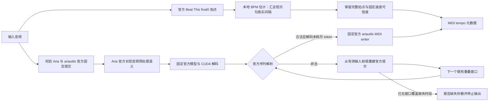

# 钢琴转写故障分析 / Piano transcription investigation

## 修正范围

本次修正本地 BPM 估计对短乐句的误判、Aria 长音频预处理偏离官方实现，以及本地封装遗漏官方跨窗口恢复流程的问题。Beat This 检测器、Aria-AMT 模型与权重、官方 CUDA 解码和推理精度均未修改。MIDI 仍由官方 writer 生成，其依赖升级为固定官方 `ariautils` 提交 `7c815755c6889a784b6a1b3343e9e8daa3e7d128`，使用上游已提供的同起点/零时值音符修正；没有在项目中改写 writer。自定义 token 约束、跨窗状态排序及改变 BF16 累加设置的诊断方案不作为交付实现。官方恢复可以由后续重叠窗口重新生成失败时段，但不保证所有非法序列都能恢复；未恢复区间不能作为完整 MIDI 交付。

## 节拍误判的原因与修正

`_fit_sparse_observed_period` 原先只保留至少八个连续拍点的乐句。多个短乐句即使合计有足够的真实拍间隔，也会全部被舍弃。另一个问题是，在回归之前先用初始拍间隔中位数的 ±5% 切断乐句；检测器的 20 ms 时间格会使短间隔发生取整偏差，这个筛选可能使保留数据偏向初始中位数。

修正后，每个至少有两个拍点的局部乐句提供自身的拍序号与时间协方差。长于八个参考拍的间隔仍切断乐句；拍序号偏差超过四分之一参考拍、或过近的拍点也不能直接用于局部序号连接。不同乐句分别中心化后汇总拟合，不为长空白虚构连续拍序号。

有效间隔合计必须至少为七个，且必须有足够的局部自由度评估误差。局部直线残差及周期估计的不确定性仍受既有 5% 误差尺度约束。各乐句真实的速度变化交给后续全局可信度判断，不通过删除拍点恢复固定速度。所有原始拍点继续进入固定速度/变速判断；补出的拍点不计入检测证据。无证据、节拍混乱和速度越界仍报错。

没有新增模型推理、重试或第二次转写。该估计属于项目的 MIDI tempo 元数据处理，不是 Beat This 模型修改，也不是 Aria 官方解码算法的一部分。

## 本机复现

- 环境：Windows、Python 3.11.15、Torch/torchaudio 2.7.0+cu128、NumPy 1.26.4、RTX 4070 Ti SUPER。
- 反馈中的两个原 WAV 不在本机，不能声称已验收原文件。
- 本机另一首 240.9836 秒钢琴分轨能触发 Aria 非法序列。旧适配在第九个 30 秒窗口（源音频 80～110 秒）生成 `on 70 → onset 16950 → on 46`，缺少官方 tokenizer 要求的力度事件。保存相同前缀与输入重放官方 `process_segments` 可再次复现。
- 固定官方 Aria 源码为 `a1ab73fc901d1759ec3bc173c146b3c6a3040261`；checkpoint 为 `piano-medium-double-1.0.safetensors`，SHA-256 为 `089d3129dbe93246aeda55efe668c8a48af08afaf9dd15c64cef0a07c0fb30a4`。已核验源码与权重身份，未改动安装包。
- 官方长音频读取使用 FFmpeg StreamReader，本地适配使用整段 torchaudio 重采样。补齐仅用于诊断的 FFmpeg 6.1.1 动态库后，两者均输出 24 个窗口，但采样值并非位级相同。换用官方读取的第九窗、保留同一有效前缀后，官方解码仍生成 `on 70 → onset 8450 → off 70`，同样缺少力度事件。因此输入读取差异不能作为这次错误已解决的依据；该重放前缀来自本地前序窗口，不能冒充完整官方入口对照。
- 随后的完整官方对照使用官方 `get_wav_segments`、`process_segments`、`transcribe_file` 和 MIDI writer，24 个窗口均通过，无解析失败或跳窗，共 6843 个音符。为在 Windows 无共享 FFmpeg DLL 的情况下保持相同输入，项目通过已有 FFmpeg 可执行文件使用同一 `aresample=16000,aformat=sample_fmts=flt` 滤镜，保留原声道直到重采样结束再取均值。30 秒以内仍沿用官方的先均值、再 torchaudio 重采样分支。
- 修正后的本地完整转写，在诊断中固定相同 Python 随机种子 0（产品没有新增种子设置或状态重排），全部 24 个输入窗口逐样本相同、生成序列逐 token 相同，最终 MIDI 字节也相同。MIDI SHA-256 为 `2c4096728eac43ab0effca5102fec36e575d60a03ce113ea14b651a6c4cf90a1`。6843 个音符均可配对且时值为正。该证据支持音频适配已对齐官方，不能据此推断反馈者原文件已经通过。
- 补做的旧读取器固定种子 0 对照同样能完成 24 窗，但得到 6419 个音符，与官方输出不一致。音符数量差异不代表精度高低，也不能据此把所有非法序列归因于重采样。已确认并修正的是本地前处理偏离官方这一事实；官方解码对已保存的有效前缀仍能生成非法事件，所以不能宣称该模型的所有 `Unexpected token order` 已被根治。
- 为复现节拍报错，从上述真实钢琴录音保留每 12 秒中的前 3 秒，其余设为静音。真实 Beat This 输出 146 个拍点，最长间隔 21.46 秒。旧算法抛出截图中的长空白错误；新算法估计 121.4144 BPM，仍标记固定速度不可靠。未加静音的录音检测为 121.9195 BPM，仅作为同源对照，不能称为人工真值。
- 取上述稀疏样本的前 60 秒，经最终适配器、实际 `InferenceEngine`、Beat This 与未修改的官方 Aria CUDA 解码，得到 190 个音符、121.1180 BPM；旧节拍算法对同一原始检测结果仍抛出原错误。桌面真实 Qt 结果页的中英显示、播放/暂停/停止和导出均通过，导出保留 190 个音符。该样本证明节拍修正可以走通实际流程，不证明 Aria 对其他输入不再报错。此前仅修改节拍时的 376 音符结果属于旧读取器阶段，不是最终适配器的验收输出。

本机诊断输入、原始 token、日志与 MIDI 保存在 `.tmp/piano-root-cause/`，不随仓库分发。该目录中的 `fixed-aria-*` 为已撤销的自定义解码实验，不能作为当前代码的验收结果。

## 官方跨窗口恢复

旧本地封装直接调用 `_truncate_seq`，解析异常会中止整首。固定官方版本的 `transcribe_file` 在同一位置保存输入前缀；发生异常时，从有效输入前缀截取 `9998～10000 ms` 的状态，交给下一个原本就要处理的窗口。30 秒音频窗口每次前移 10 秒，解码输出到相对 20 秒，因此下一窗有机会重新生成上一窗缺失的 10 秒。该过程没有重跑旧窗口，也没有改变模型输出规则。

共享 `AriaSequenceStitcher` 复用官方 `_truncate_seq`、`_shift_onset` 和提示恢复参数。输入前缀须在 `process_segments` 原地补齐到 4096 token 之前深拷贝；直接持有同一个列表会破坏恢复与拼接边界。CUDA/XPU、子进程、打包入口都调用这一封装。GPU/读取错误和用户取消不进入序列恢复。

序列通过官方解析，且没有耗尽官方 4096 token 上限，才能推进已完成区间。是否耗尽上限在官方静音处理之前记录，避免静音处理缩短列表后掩盖原始解码未完成的事实。中间窗失败后，如果下一窗从缺失区间起点开始并成功，使用其真实输出；如果连续失败使下一个窗口已越过缺失区间，或到达文件末尾仍未恢复，则报告缺失秒数及原始错误，不保存完整输出。实时预览只更新成功窗口；错误窗口不会将播放边界推进到尚未恢复的时段。自然静音由官方 EOS/静音处理判断，不用“该段必须有音符”冒充覆盖验证。

`tests/test_aria_amt_sequence.py` 以真正的官方 `transcribe_file` 为参照核对正常、单次恢复和多次不连续恢复的提示、调用次数、拼接及 MIDI 字节，并检查连续失败、首尾失败、token 上限、取消、GPU 错误及中英文错误占位符。测试中的受控 token 序列只用于协议回归；真实 GPU 验收须单独记录。

完整 GPU 对照另使用诊断种子 1：官方入口在第 22 窗（索引 21）生成 `on 64 → onset 17880 → off 64`，第 23 窗恢复。恢复流程初验使用旧 writer，24 窗的生成 token 与官方逐项一致，6598 音符 MIDI 的旧版 SHA-256 为 `e7249a6999b5e64c1c3ddb0a8850d77662010bb151ffecba7d15538ba23bef6b`。没有通过删除非法 token 获得这个结果；原非法窗口仍被独立观察器记录，下一窗的真实生成结果补回该时段。此处种子只用于对照实验，不进入产品。最终 writer 升级后的验收如下。

## 官方 MIDI 依赖修正与最终验收

不固定种子的另一轮真实 GPU 运行处理了 24 窗；索引 6 耗尽 token、索引 20 生成非法事件，都由下一重叠窗口恢复。旧版 `ariautils` 写出了 6909 个 note-on，其中一条原始音符起止时间均为 210760 ms；按 MIDI 事件顺序检查，出现一条无对应开启的关闭事件和一条未关闭的开启事件。因此“已写出 MIDI”不等于该次输出的事件配对已经通过验收。

项目原来固定 `ariautils` 提交 `93da092204e5b1189ed8e0259f6156266fd086a7`。官方当前提交 `7c815755c6889a784b6a1b3343e9e8daa3e7d128` 的 writer 已修正同起点音符与零时值音符处理。先在隔离目录安装未修改的官方包，再使用上述真实 GPU token 对照：两组样本的跨窗提示语义未改变；新版官方 writer 将异常输出写为 6908 条有效音符，开关事件全部配对、时值均为正。零时值事件的处理来自官方库，没有加入项目级音符过滤、补时值或修改 token。

根目录 requirements、Space requirements 与 Colab 同步固定该提交。本机环境也已更新，Torch/torchaudio 版本保持不变。新旧库的包版本号都为 `0.0.1`，所以运行时检查同时核验 `ariautils` 的安装来源提交；旧来源触发已有的一键安装流程。Space 修复流程用同一条 `--no-deps` 安装命令恢复 Aria 和 ariautils；PyInstaller 额外收集 ariautils 来源元数据，便携入口使用相同校验。

最终环境重新完成 240.9836 秒录音的 GPU 转写：24 窗、6598 条音符，全部配对且时值为正。所有生成 token 与独立官方 GPU 参考逐项相同；再由当前官方 `transcribe_file` 使用本次 GPU token 重放拼接，逐窗核对全部音频样本哈希和**精确前缀顺序**，经当前官方 writer 写出的 MIDI 与产品文件字节相同。最终 SHA-256 为 `46baabf905e0f73fce862ddeb9af3bfd7c0145366f5c54f46dcd77d3ad54e626`。这包含真实 GPU 运行和独立官方拼接/writer 对照；不能把后者的 token 重放称作第二次 GPU 推理。

最终环境的 60 秒稀疏样本经实际 API 引擎得到 190 音符、121.1180 BPM，并保留固定速度不可靠标记；旧节拍算法对同一批真实拍点仍报原错误。真实 Qt 界面在 `zh_CN`、`en_US` 下完成播放、暂停、停止和导出，导出保留 190 音符；新增三条错误信息也完成两种语言的可见渲染检查。最终记录为 `.tmp/piano-root-cause/final-acceptance.json`，最终回归日志为 `final-regression.log`。

## 性能与兼容性

没有增加模型推理次数、重试或备选后端。官方恢复使用已经安排的下一重叠窗口；恢复窗口需要生成的 token 数可能与无错误窗口不同，不能把“未增加窗口数”写成所有输入总耗时完全不变。长音频读取复用各交付面已有的 FFmpeg 可执行文件，不新增产品运行时的共享 FFmpeg DLL 依赖。诊断用 FFmpeg 6.1.1 动态库仅用于独立运行官方读取函数，不属于交付实现。

对本机 241 秒录音交替测试两个读取器、去掉预热后各七次，单独读取耗时中位数为旧实现 0.0956 秒、官方对齐实现 0.2594 秒，约增加 0.164 秒。为避免把读取耗时累加到模型加载后，最终实现用一个读取线程准备首窗，同时由原线程加载模型；首窗准备完成后，全部 CUDA 推理仍在原线程按原顺序执行。线程异常会正常传回，不进行重试或回退。

交替测试“模型加载＋首窗准备”、去掉预热后每种五次，中位数为旧串行实现 0.4753 秒、对齐后的串行实现 0.6266 秒、最终并行实现 0.4467 秒。这证明本机准备阶段没有因为官方对齐而变慢，不构成跨机器或全输入的总耗时保证。完整转写耗时受其他 GPU 作业、预热及不同输入产生的 token 数影响，不能拿不同运行的总耗时声称模型推理加速。

## 交付面与验收边界

所有交付面经共享 `BeatThisTracker` / `telknet_beat_grid_v12` 使用该修正，不需要各平台另写模型处理。桌面结果页与独立 Web/API 引擎已做本机真实运行；Space、Colab、Docker、便携包与可执行入口通过对应路由、部署和打包契约检查覆盖。契约检查不等于重新发布远端应用、构建便携包，或完成 Linux/XPU 实机推理。此处记录发布前源码验收，打包发布状态以对应 Actions 和 Release 为准。

| 交付面 | 本次证据 |
| --- | --- |
| 桌面 | 实际 Qt 播放、暂停、停止、导出；钢琴 CUDA、Aria runtime 与项目队列测试 |
| Space | `test_platform_ui_parity.py` 与 `test_project_frontends.py` 的共享核心及入口契约 |
| Colab | 平台 UI 契约与 `test_colab_notebook_dependencies.py` |
| 独立 Web/API | 实际 `InferenceEngine` 转写；`test_web_api.py`、`test_midi_stem_api.py` |
| Docker | deployment、production、runtime 三组部署契约 |
| 便携包 / 可执行入口 | `test_portable_release_contract.py`、`test_runtime_paths.py` 与 CLI tempo 契约 |

最终相关回归合计 476 项测试通过。新增恢复失败、token 上限、依赖来源错误文本覆盖当前全部语言 `zh_CN`、`en_US`，检查键集合、占位符、实际解析及可见渲染；README 与工程说明同步提供中文和英文。图谱检查出现空符号 ID 及错误关联整仓调用的问题，未将其风险等级当作有效范围证明；实际调用点经源码核查，并按上述受影响路径验证。

相关回归：`test_aria_amt_audio_parity.py`、`test_sparse_phrase_tempo.py`、`test_sparse_tempo_evidence.py`、`test_beat_this_tracker.py`、`test_telknet_tempo_v12.py`、`test_tempo_map_detection.py`、MIDI tempo 保留/对齐、Aria runtime/transcriber、API、平台 UI 与打包部署契约测试。音频回归中的参考值由固定官方 StreamReader 读取自建合成 PCM 得到，不含用户音频。

## 上游依据

- [固定 Aria 官方推理代码](https://github.com/EleutherAI/aria-amt/blob/a1ab73fc901d1759ec3bc173c146b3c6a3040261/amt/inference/transcribe.py)：解码、跨窗衔接及保存流程。
- [固定 Aria 官方音频读取](https://github.com/EleutherAI/aria-amt/blob/a1ab73fc901d1759ec3bc173c146b3c6a3040261/amt/data.py)：长音频 StreamReader 与短音频读取分支。
- [固定 ariautils 官方 writer](https://github.com/EleutherAI/aria-utils/blob/7c815755c6889a784b6a1b3343e9e8daa3e7d128/ariautils/midi.py)：同起点音符、零时值、踏板事件与 MIDI 写出。
- [TorchAudio 2.7 安装文档](https://docs.pytorch.org/audio/2.7.0/installation.html)：StreamReader 依赖可加载的 FFmpeg 4～6 动态库；单独的 FFmpeg 可执行文件不能代替动态库。

## English

This change corrects sparse-phrase BPM estimation, aligns audio preprocessing with official Aria, and restores overlapping-window recovery omitted by the local wrapper. Beat This, Aria weights, inference precision and official CUDA decoding are unchanged. MIDI writing uses the unmodified official ariautils revision `7c815755c6889a784b6a1b3343e9e8daa3e7d128`, including its upstream fixes for same-start and zero-duration notes. Custom token constraints, prefix sorting and changes to BF16 accumulation settings are not shipped. Official recovery can regenerate a failed interval, but cannot guarantee recovery of every invalid sequence. Output with an unrecovered interval must not be delivered as complete MIDI.

The old estimator discarded every phrase with fewer than eight contiguous beats. Its preliminary ±5% gate around the frame-quantized median could also bias or eliminate short phrases. The revised estimator pools centered observations from short phrases without assigning beat ordinals across long silence. It requires at least seven real within-phrase intervals, positive residual degrees of freedom, bounded local timing residuals and bounded period uncertainty. Complete observations still reach global tempo reliability classification, including real tempo changes between phrases. No model pass, retry or second transcription is added.

A local 240.9836-second piano stem reproduced invalid Aria output at window 8. Replaying its saved prefix through the unchanged official decoder reproduced the failure. Official StreamReader audio differs numerically from the project's full-file torchaudio resampling; substituting the official audio for that window still produced an event missing velocity. The carried prefix came from the earlier local run, so this replay alone does not establish a complete official-entrypoint comparison. Pinned source and checkpoint identities are recorded above.

The subsequent complete official run passed all 24 windows without reconciliation failures or skipped windows and wrote 6843 notes. The corrected adapter uses the existing FFmpeg executable with the official resampling filter, keeps original channels during resampling, and averages them afterwards. Inputs of at most 30 seconds retain official mean-then-torchaudio-resample semantics. With the same diagnostic Python seed 0, all 24 input windows, all generated tokens and final MIDI bytes matched the official reference. All 6843 notes were paired with positive durations. The MIDI hash is recorded above; product code does not fix or reorder the official random state.

A control using the old reader with seed 0 also completed all 24 windows, but returned 6419 notes, unlike the official reference. Note count alone does not establish accuracy or attribute every invalid sequence to resampling. The adapter deviation is confirmed and corrected; official decoding can still generate invalid events from the saved valid prefix, so eliminating all possible `Unexpected token order` errors is not claimed.

The former wrapper aborted when `_truncate_seq` rejected a generated sequence. Official `transcribe_file` instead reconstructs the prompt from the valid input prefix at 9998–10000 ms and proceeds to the next scheduled window. Audio windows are 30 seconds with a 10-second stride and a 20-second generation horizon, allowing the next window to regenerate the missing 10 seconds. `AriaSequenceStitcher` now uses the same upstream helpers and parameters. The prefix is deep-copied before inference pads its list to 4096 tokens in place. No failed window is re-run, and decoder decisions remain unchanged.

A successfully parsed sequence advances coverage only if it has not exhausted the 4096-token context. Exhaustion is recorded before silence processing can shorten the sequence and hide it. A later window must still cover the missing interval; consecutive failures or an unrecovered tail stop publication and report the affected seconds with the original error. Failed windows do not advance streaming previews. Silence follows official EOS/silence processing, not a requirement to invent notes in every interval. GPU errors, reader failures and cancellation bypass recovery. Tests compare prompts, inference counts, stitching and MIDI bytes against actual official `transcribe_file`, and cover unrecoverable intervals, context exhaustion, cancellation, GPU errors and both supported error-message locales. Controlled token tests are protocol evidence, not real model inference.

Recovery adds no inference window or retry relative to the official workflow. A recovery window can generate more tokens than an ordinary window, so equal window counts do not imply identical runtime for all inputs.

A second complete GPU comparison used diagnostic seed 1. Official inference generated `on 64 → onset 17880 → off 64` in window 21 and recovered in window 22 (zero-based). Initial recovery acceptance used the older writer: every generated token sequence and the 6598-note MIDI bytes matched the official run, with SHA-256 `e7249a6999b5e64c1c3ddb0a8850d77662010bb151ffecba7d15538ba23bef6b`. The observer still recorded the invalid window; its missing interval came from real generation in the next window, not token deletion. The seed is diagnostic only. Final acceptance after the writer dependency upgrade follows.

An unseeded 24-window GPU run recovered a context overflow at window 6 and an invalid sequence at window 20. The former pinned ariautils revision `93da092204e5b1189ed8e0259f6156266fd086a7` wrote 6909 note-ons, including a note with equal start/end at 210760 ms that produced an unmatched off and on in MIDI event order. The official revision `7c815755c6889a784b6a1b3343e9e8daa3e7d128` fixes same-start and zero-duration handling. Its unmodified package was verified in an isolated directory using the real saved GPU tokens: prompt semantics remained unchanged, while its writer produced 6908 valid, positively timed, fully paired notes. This uses upstream behavior, not project-level note filtering or invented durations.

Root requirements, Space requirements and Colab now pin the same commit, and the local runtime was updated without changing Torch/torchaudio. Both old and new ariautils packages report version `0.0.1`, so runtime availability also validates installation-source identity. Old sources trigger the existing installer. Space repairs both pinned packages in one `--no-deps` command, and PyInstaller includes ariautils source metadata.

The final environment completed a fresh GPU run of the 240.9836-second recording: 24 windows and 6598 fully paired notes with positive durations. All model token sequences matched the independent official GPU reference. Current official `transcribe_file` then replayed those real GPU tokens with all audio hashes and exact prompt orders checked, and the current official writer produced identical MIDI bytes. Final SHA-256: `46baabf905e0f73fce862ddeb9af3bfd7c0145366f5c54f46dcd77d3ad54e626`. This combines real GPU execution with independent official stitching/writer replay; the replay is not a second GPU inference run.

The final 60-second sparse sample passed the actual API engine with 190 notes and 121.1180 BPM, retaining the unreliable-fixed-tempo flag; the old estimator still rejected the same real detections. Actual Qt playback, pause, stop and export passed in both supported languages, retaining all 190 notes. All three new error messages were also visibly rendered in Chinese and English. Final evidence is in `.tmp/piano-root-cause/final-acceptance.json` and `final-regression.log`.

No model pass, retry or alternate backend was added. The shared FFmpeg 6.1.1 DLLs were used only by the independent diagnostic reference; production uses its existing executable. Seven alternating post-warmup timing samples per reader gave median 0.0956 seconds before and 0.2594 seconds after for the 241-second recording. The final implementation overlaps first-window reading with model loading while retaining CUDA inference on the original thread. Five post-warmup samples per preparation mode gave median 0.4753 seconds for the old serial preparation, 0.6266 seconds for aligned serial preparation, and 0.4467 seconds for the final concurrent preparation. Startup preparation did not regress on this machine; this is not a universal end-to-end timing guarantee. Different GPU loads and generated token counts prevent claiming faster model inference from full-run timings.

Gating the recording to three audible seconds per twelve seconds produced 146 real Beat This detections and reproduced the original long-gap error. The revised estimate is 121.4144 BPM and retains the unreliable-fixed-tempo flag; the ungated recording measured 121.9195 BPM, which is a consistency reference, not human ground truth. A 60-second excerpt completed the final adapter and actual API engine with official Aria decoding: 190 notes, 121.1180 BPM. Actual Qt playback, pause, stop and export passed in both supported languages and retained all 190 notes. The earlier 376-note result was from the tempo-only correction with the old reader, not final adapter acceptance.

The shared core serves desktop, Space, Colab, Web/API, Docker and portable/executable entrypoints. Local desktop and API execution plus platform, deployment and packaging contracts cover this change. This does not establish fresh remote deployment, portable builds or physical Linux/XPU acceptance. The reporter's original WAVs are unavailable. Diagnostic artifacts are local only; withdrawn custom-decoder experiments are not acceptance evidence. This is pre-release source verification; packaging and publication status belongs to the corresponding Actions and Release.

The final regression suite passed 476 tests. New incomplete-recovery, context-limit and dependency-source messages cover all supported languages, `zh_CN` and `en_US`, with key-completeness, placeholder, parsing and visible-rendering checks. README and engineering notes cover both languages. GitNexus returned empty symbol IDs and unrelated repository-wide associations, so its reported risk was not treated as reliable scope evidence; callers were verified in source and covered through the listed execution and contract tests.

## 官方 Torch 2.5 对照 / Official Torch 2.5 comparison

2026-10-12 在独立诊断目录安装 Torch/torchaudio `2.5.0+cu124`，未替换应用的 `2.7.0+cu128`。同一 240.9836 秒钢琴音频使用官方读取、CUDA 解码、`transcribe_file` 拼接及 writer 完成 24 窗；诊断种子为 1，产品没有固定种子。第 8 窗（索引 7）生成 `on 70 → onset 18380 → off 70`，缺少力度，官方解析抛出 `Unexpected token order`。下一窗恢复后输出 6,213 条正时值、完全配对音符，总耗时 216.422 秒，MIDI SHA-256 为 `983997193de7dd983301278b25e84b1f6bbfbca533f49d5deef1a192f380c055`。该结果排除了“只有 Torch 2.7 才会出现非法序列”的说法，不能保证所有失败窗都能恢复，也不把 6,213 与应用已验收的 6,598 音符数量差异解释为质量评分。

官方主分支的解码器、模型、tokenizer 与依赖声明在核验时均与固定提交相同；已安装的 14 个 Aria Python 文件在仅归一化 Windows 换行后与官方源码完全一致。未发现可直接升级的已合并解码修复。两个 pip 依赖声明冲突按维护者决定保留；没有改官方包元数据、模型权重、解码精度或推理规则。记录保存在本机 `music-to-midi-muscriptor-investigation-20261012/aria-official-torch25/` 与 `duration-and-aria-followup.json`。

English: a separate diagnostic environment with Torch/torchaudio `2.5.0+cu124` completed all 24 windows of the same 240.9836-second piano recording using the official reader, CUDA decoder, `transcribe_file` and writer. Diagnostic seed 1 does not enter production. Window 8 emitted `on 70 → onset 18380 → off 70` without velocity and raised the official `Unexpected token order` error. The next window recovered; the final MIDI contained 6,213 positively timed, fully paired notes in 216.422 seconds, SHA-256 `983997193de7dd983301278b25e84b1f6bbfbca533f49d5deef1a192f380c055`. Invalid sequences therefore also occur with the declared Torch/torchaudio 2.5 generation, not only 2.7. Recovery is not guaranteed for every input, and note-count differences against the accepted 6,598-note application run are not accuracy scores.

The checked official main-branch decoder, model, tokenizer and dependency declaration match the pinned revision. All 14 installed Aria Python files match upstream after Windows newline normalization. No merged decoder fix suitable for a direct upgrade was found. The application's runtime, weights, precision and decoding remain unchanged; the two dependency metadata conflicts remain by maintainer decision, without package metadata rewriting.
